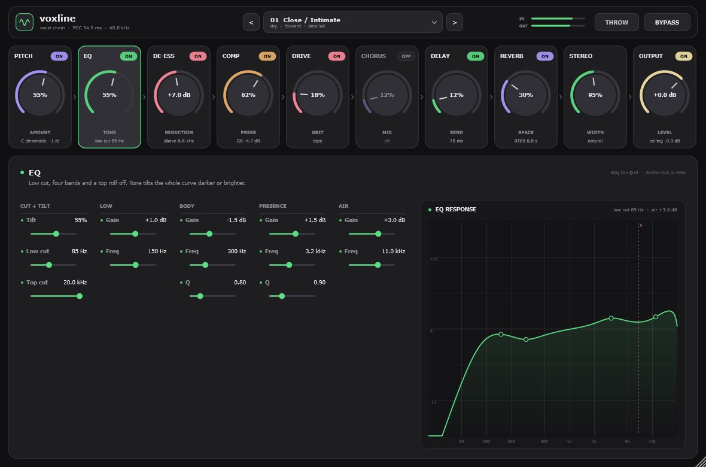
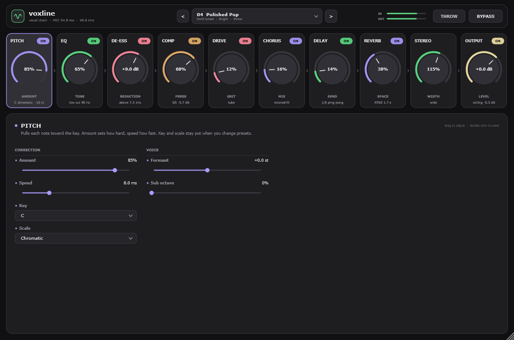
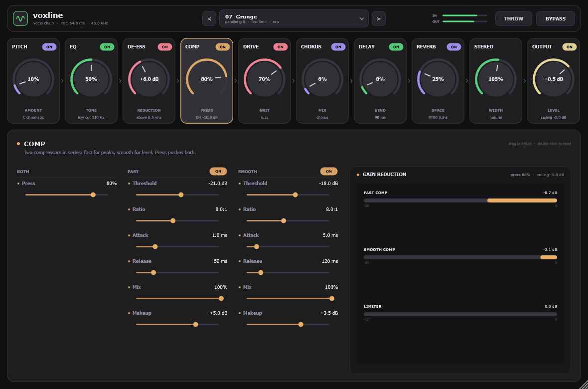
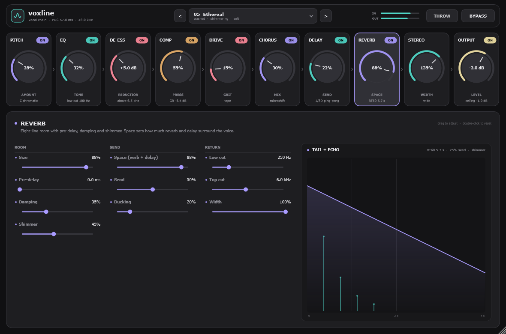
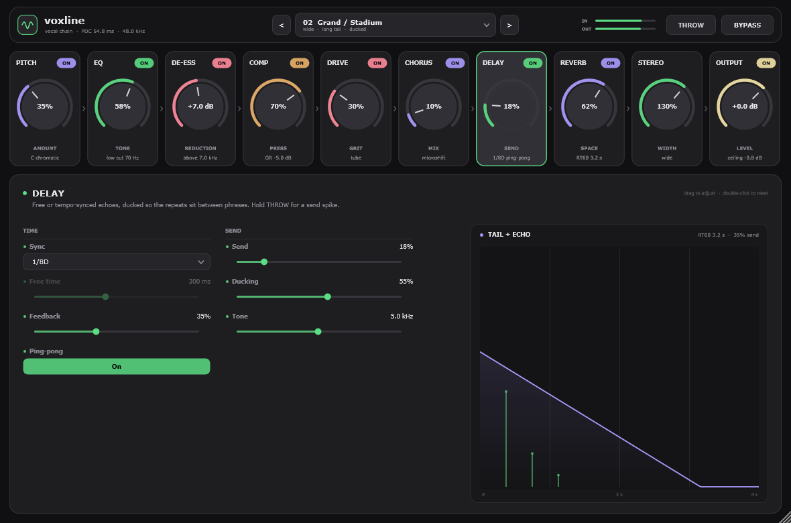
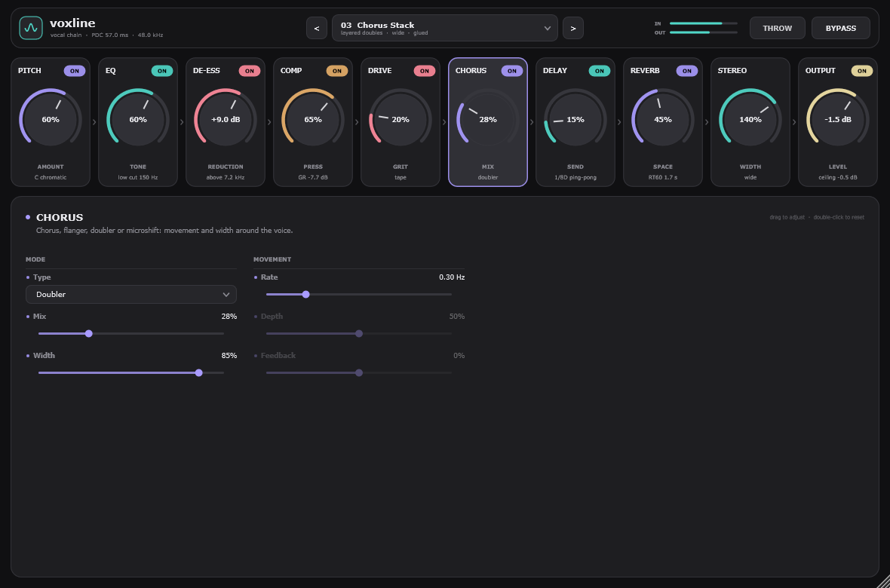

# voxline

A vocal chain in one JUCE plugin: pitch correction, EQ, de-esser, compression,
distortion, chorus, delay, reverb, stereo width and a limiter. Every stage is on one
page with an on/off switch and one main knob; click a stage to see all its controls.
VST3 and standalone for Windows, built with JUCE 8.0.6.



## Download

Every push to `main` builds the Windows installer and the VST3, runs the DSP and
smoke checks, and publishes them as the
[**latest**](https://github.com/invot/voxline/releases/tag/latest) release (see
`.github/workflows/release.yml`). The installer puts the standalone app in Program
Files and `voxline.vst3` in the shared VST3 folder
(`C:\Program Files\Common Files\VST3`); the zip is the VST3 bundle on its own. A
build whose checks fail is not published, and the previous release stays up.

## The interface

The page has three parts.

- **Header.** The preset selector with previous/next, the input/output meters,
  **THROW** (hold to spike the delay send) and **BYPASS**. The reported delay
  compensation (PDC) and sample rate sit under the logo.
- **The chain.** Ten tiles, one per stage, in signal order. Each has an on/off
  switch, the knob that matters most for that stage, and a one-line readout: key
  and live tuning, gain reduction, reverb time, delay sync and so on.
- **The selected stage.** Click any tile (or grab its knob) and every control for
  that stage appears below it, grouped, next to a graph where one helps: the EQ
  curve, the reverb tail with delay taps, or gain-reduction bars. Controls that do
  nothing in the current mode fade back, such as crush bits outside Crush, or free
  delay time while synced. Double-click any knob or slider to reset it.

| Stage | Main knob | Every control |
|-------|-----------|---------------|
| **Pitch** | Amount | amount, retune speed, key, scale, formant, sub-octave |
| **EQ** | Tone (tilt) | tilt, low cut, top cut; gain/frequency for low, body, presence and air, plus Q for body and presence |
| **De-ess** | Reduction | maximum reduction, threshold, frequency (marked on the EQ graph) |
| **Comp** | Press | Press, then a fast and a smooth compressor, each with its own switch: threshold, ratio, attack, release, mix, makeup |
| **Drive** | Grit | type (tube, tape, fuzz, crush), grit, drive, mix, tone, crush bits |
| **Chorus** | Mix | type (chorus, flanger, doubler, microshift), mix, width, rate, depth, feedback |
| **Delay** | Send | sync (free, 1/32 to 1/2 with dotted and triplet), free time, feedback, ping-pong, send, ducking, tone |
| **Reverb** | Space | size, pre-delay, damping, shimmer, Space, send, ducking, return low/top cut, width |
| **Stereo** | Width | overall mid/side width, chorus width, reverb width |
| **Output** | Level | level; the switch is the limiter, with ceiling and release |

The main knobs on Pitch, EQ, Comp, Drive, Reverb, Stereo and Output are the
plugin's seven macros (Tune, Tone, Press, Grit, Space, Width and Level), with the
same parameter IDs as before, so existing automation still applies. **Space** scales
both the reverb and delay sends; **Press** shifts both compressor thresholds.

### Screenshots

| | |
|---|---|
|  |  |
| **Pitch** on *Polished Pop*: hard, fast correction with a sub-octave layer | **Comp** on *Grunge*: both compressors and the limiter with live gain reduction |
|  |  |
| **Reverb** on *Ethereal*: long shimmer tail with dotted-eighth echoes | **Delay** on *Grand / Stadium*: synced ping-pong, ducked under the voice |
|  |  |
| **Chorus** on *Chorus Stack*: doubler mode, with depth and feedback faded since they don't apply | **EQ** on *Close / Intimate*: the live curve, with the de-esser frequency marked |

These are generated by the smoke harness (`./build.sh smoke`) at 1180x780, after
running a synthetic vocal through each preset so the meters are live.

## Signal flow

```
Pitch -> EQ -> De-ess -> Fast comp -> Smooth comp -> Drive -> Chorus -> Delay -> Reverb -> Stereo -> Level -> Limiter
```

## Presets

| # | Preset | Character | Good for |
|---|--------|-----------|----------|
| 01 | Close / Intimate | dry, forward, detailed | solo verse, close mic, spoken word |
| 02 | Grand / Stadium | wide, long tail, ducked | big choruses, live, anthemic |
| 03 | Chorus Stack | layered doubles, wide, glued | stacked harmonies and ad-libs |
| 04 | Polished Pop | hard tuned, bright, throw | modern pop lead |
| 05 | Ethereal | washed, shimmering, soft | ambient vocals, intros, textures |
| 06 | Robotic | hard tuned, crushed, metallic | effect vocal, robot hook |
| 07 | Grunge | parallel grit, fast limit, raw | rock, punk, aggressive takes |
| 08 | Telephone | band-passed, mono, lo-fi | FX, skits, filtered verses |
| 09 | Rap / Front | tight, dry, present | rap lead, fast delivery |
| 10 | Air / Whisper | breathy, close, delicate | quiet, intimate, whisper layers |
| 11 | Lead Double | tight tuned, tucked, de-essed | unison doubles of the lead |
| 12 | Harmony Stack | wide, dark, blended | stacked 3rds/5ths behind a chorus |
| 13 | Ooh / Pad | soft, washed, very wide | sustained oohs and aahs, pads |
| 14 | Gang / Shout | crunchy, mid-forward, roomy | gang vocals, chants, crowd hooks |
| 15 | Ad-libs | filtered, wide, thrown | ad-libs, call-and-response |

Every preset sets every stage explicitly: pitch, EQ, de-esser, both compressors,
drive, chorus, delay, reverb, stereo width and the limiter, including whether each
is on. Nothing is left to a default. The smoke harness fails if a preset leaves a
parameter out, sets one twice, or uses a value outside its range.

Presets 11-15 are for backing vocals. They sit behind a lead rather than in front
of it: a higher low cut and a presence dip leave the lead its space, the de-esser
works harder because stacked esses add up, tuning is tighter so parts lock
together, and the width and returns are wider than a lead would get.

The presets are gain-staged to come out at roughly the same level (within about
1 dB on the smoke harness's test vocal), so switching presets compares sound, not
loudness.

**Key and scale are not part of a preset.** They belong to the song, so changing
presets keeps them. Bypass is untouched too.

## Latency and bypass

The tuner is always running, so the latency is constant whether Pitch is on, off or
the plugin is bypassed. At 48 kHz the chain reports **2632 samples (about 55 ms)**:
2048 samples of Signalsmith Stretch, 512 samples of FIFO priming,
and 72 samples of limiter look-ahead. The host's delay compensation
handles it.

Bypass is latency-matched and crossfades over about 25 ms. The chain keeps running
underneath, so switching back has no jump. Once the fade settles, bypass is the
input exactly.

## Build

### Windows

The project uses the bundled toolchain next to the sibling `SightLine` checkout:

- JUCE 8.0.6 at `../SightLine/.tools/JUCE-8.0.6`
- MinGW GCC 16.2 and CMake 3.31.6 under `../SightLine/.tools`

```bash
./build.sh           # configure if needed, build the VST3 and standalone
./build.sh tests     # build and run the headless DSP checks
./build.sh smoke     # build and run the processor/editor smoke + screenshots
./build.sh icon      # redraw Source/platform/voxline.ico from the interface mark
./build.sh clean     # remove build/ first
```

Outputs:

```
build/Voxline_artefacts/Release/VST3/voxline.vst3
build/Voxline_artefacts/Release/Standalone/voxline.exe
```

The build script sets the MinGW force-includes (JUCE 8 needs a UI Automation enum
that GCC 16's Windows headers omit) and the `SIGHTLINE_MANIFEST_RC` variable that
the vendored JUCE checkout uses to give its `juceaide` helper a Common Controls v6
manifest. Build through `build.sh`; a direct CMake configure will not set those.

If JUCE is somewhere else, pass `-DVX_JUCE_DIR=...` to CMake, or edit `VX_JUCE_DIR`
in `CMakeLists.txt`. If the toolchain moves, edit `TOOLS` in `build.sh`.

### macOS

The macOS script builds universal Apple Silicon + Intel VST3 and standalone
bundles for macOS 11 or newer. Install Xcode Command Line Tools and CMake 3.22+,
then get the same JUCE version used by the Windows build:

```bash
xcode-select --install   # if the developer tools are not installed yet
brew install cmake
git clone --depth 1 --branch 8.0.6 https://github.com/juce-framework/JUCE.git .tools/JUCE-8.0.6
bash ./build-macos.sh
bash ./build-macos.sh tests
bash ./build-macos.sh smoke   # requires a graphical macOS session
bash ./build-macos.sh clean   # remove build-macos/ and rebuild
```

The build uses Apple Clang and a separate `build-macos/` directory. Outputs:

```text
build-macos/Voxline_artefacts/Release/VST3/voxline.vst3
build-macos/Voxline_artefacts/Release/Standalone/voxline.app
```

Set `VX_JUCE_DIR=/path/to/JUCE` to use another checkout. The script also accepts
the existing `../SightLine/.tools/JUCE-8.0.6` checkout if the local copy is absent.
The `tests` command can run without JUCE. Set `VX_MACOS_ARCHITECTURES=arm64` or
`VX_MACOS_ARCHITECTURES=x86_64` for a single architecture, `JOBS=4` to limit build
parallelism, or `MACOSX_DEPLOYMENT_TARGET` to change the minimum macOS version.
For example:

```bash
VX_JUCE_DIR="$HOME/JUCE" VX_MACOS_ARCHITECTURES=arm64 bash ./build-macos.sh
```

Copy the complete `voxline.vst3` bundle into `~/Library/Audio/Plug-Ins/VST3/`
for a local DAW to scan, and copy `voxline.app` into `/Applications` if desired.
The script creates local builds; it does not sign, notarize, or publish them.
The rolling GitHub release below still contains Windows builds only.

### Release build (CI)

`.github/workflows/release.yml` runs on every push to `main` (or by hand from the
Actions tab) on `windows-latest`:

1. Downloads WinLibs GCC 16.2.0 and JUCE 8.0.6, both pinned by SHA-256, and applies
   `ci/juce-8.0.6-mingw.patch`. That is the same patch the local JUCE under
   `../SightLine/.tools` carries, so CI compiles exactly the code a local build does.
   The toolchain is cached between runs.
2. Configures and builds the VST3, standalone, `VoxlineTests` and `VoxlineSmoke`
   with the same flags as `build.sh`.
3. Runs both test executables; any failure stops the release.
4. Packages `dist/voxline-VST3-Windows.zip` and, with Inno Setup
   (`installer/voxline.iss`), `dist/voxline-Setup-Windows.exe`.
5. Replaces the rolling `latest` release and tag with the new files.

Both binaries are statically linked and import only Windows system DLLs, so the
installer ships nothing besides `voxline.exe` and the VST3 bundle.

## Checks

- `VoxlineTests` covers the biquads, compressor, de-esser, limiter, delay, reverb
  tail, exact tuning, bypass latency, processed latency and full-chain stability,
  plus regressions for fixed bugs:
  - the idle de-esser is flat at its own crossover;
  - the limiter's gain comes down ahead of a peak;
  - engaging bypass immediately plays the latency-matched input;
  - THROW works with the Delay stage off;
  - tuning stays continuous in both directions, including changing pitches and block sizes;
  - neutral audio matches the reported latency with 1–2048 sample blocks at 44.1, 48 and 96 kHz;
  - zero reverb pre-delay adds no buffer wraparound;
  - half-note echoes stay synced down to 20 BPM.
- `VoxlineSmoke` checks that every preset sets every stage in range, that every
  parameter has a control on the page, and that presets keep key and scale. It also
  renders every preset with a synthetic vocal (finite, not silent, under the
  ceiling) and prints each one's output level and gain reduction, round-trips program and state, selects every stage, and writes the
  screenshots above.
- Not checked here: a real DAW host scan/load or audio device I/O. The full DSP
  and preset suite runs at 48 kHz; neutral latency is also checked at 44.1 and
  96 kHz. The VST3 is unsigned, so Windows may warn on first load.

## Layout

```
Source/core/        JUCE-free DSP: tune, EQ, dynamics, drive, motion, delay, FDN reverb, chain
Source/ui/          Theme, widgets, graphs, and the ChainView (tiles + selected stage)
Source/             Parameters, presets, processor, editor
Tests/              main.cpp (DSP checks), smoke.cpp (plugin/editor checks + screenshots)
Tools/              IconGen.cpp, which draws the app icon from the interface mark
third_party/        Signalsmith Stretch and Signalsmith Linear (MIT) + licenses
ci/                 The JUCE 8.0.6 MinGW patch the release build applies
installer/          Inno Setup script for the Windows installer
.github/workflows/  release.yml: build, test and publish "latest" on every push to main
```

## Licensing

The plugin code is provided under the **AGPL-3.0**, matching the JUCE 8 AGPL
terms. A commercial JUCE licence can be used instead if you have one.

Vendored third-party code:

- Signalsmith Stretch, MIT, `third_party/signalsmith-stretch.h` and
  `third_party/signalsmith-stretch-LICENSE.txt`.
- Signalsmith Linear 0.6.6, MIT, `third_party/signalsmith-linear/` and
  `third_party/signalsmith-linear-LICENSE.txt`.
- JUCE 8.0.6, AGPL-3.0 or commercial; see the JUCE checkout for its licence.
